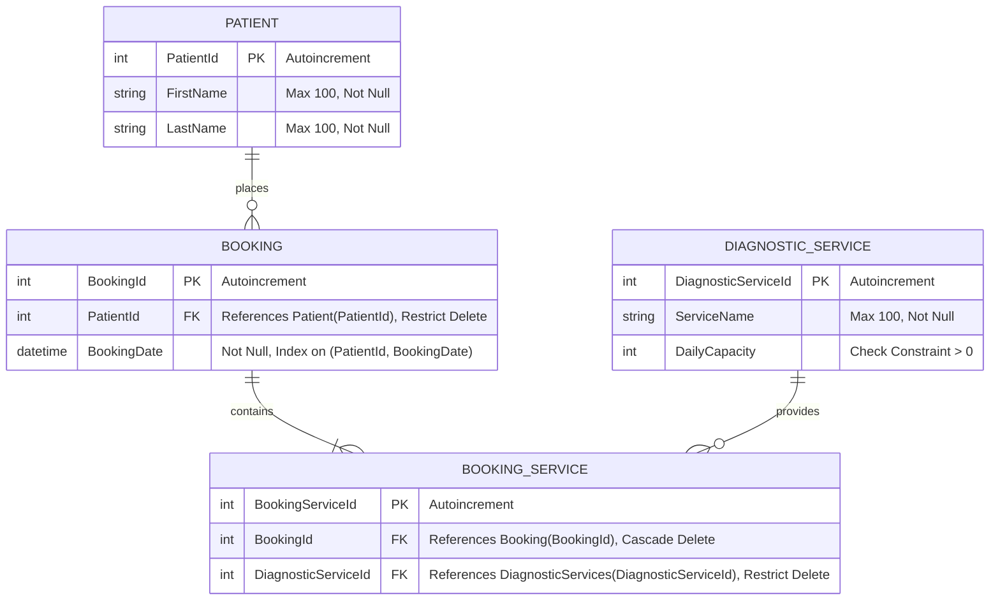

# CareFlow - Diagnostic Booking Management

**Course:** ITSD81 - Desktop Application Development  
**Performance Task 4:** CareFlow - Diagnostic Booking Management  
**Unit:** IV - Data-Driven Application Architecture and Transactional Workflows  

---

## 1. Project Overview & Architecture

CareFlow is a desktop application developed with .NET, Avalonia UI (XAML), MVVM, Entity Framework Core, and SQLite. It provides a transactional booking desk for hospital outpatient diagnostic services (e.g., Complete Blood Count, Urinalysis, Chest X-Ray, ECG, Blood Chemistry) where each service has strict daily capacity limits.

### Clean Architecture & Separation of Concerns

- **`CareFlow.Domain`**: Core domain entities (`Patient`, `DiagnosticServices`, `Booking`, `BookingService`) free from framework dependencies.
- **`CareFlow.Application`**: Application contracts (`IBookingService`, `IBookingRepository`), DTOs (`BookingRequestDto`, `BookingResultDto`, `DiagnosticServiceAvailabilityDto`, `PatientDto`), and orchestration business logic (`BookingService`) implementing rules BR-01 through BR-10.
- **`CareFlow.Infrastructure`**: EF Core database context (`AppDBContext`), entity type configurations, SQLite provider configuration, database migrations, and transactional repository implementation (`BookingRepository`).
- **`CareFlow.Desktop`**: Avalonia UI presentation layer utilizing MVVM with CommunityToolkit.Mvvm (`MainViewModel`, `ServiceSelectionViewModel`, `MainWindow`). UI controls never touch database connections or EF Core directly.
- **`CareFlow.Test`**: Automated xUnit test suite validating all mandatory business rules and acceptance scenarios (AC-01 through AC-06).

---

## 2. Relational Design

### Entity-Relationship Diagram



### Key Relationships and Constraints

1. **`Patients` table**:
   - Primary Key: `PatientId`
   - Attributes: `FirstName`, `LastName`
2. **`DiagnosticServices` table**:
   - Primary Key: `DiagnosticServiceId`
   - Attributes: `ServiceName`, `DailyCapacity`
   - Table Check Constraint: `CK_DiagnosticService_DailyCapacity` (`"DailyCapacity" > 0`)
3. **`Bookings` table**:
   - Primary Key: `BookingId`
   - Foreign Key: `PatientId` $\rightarrow$ `Patients.PatientId` (`ON DELETE RESTRICT`)
   - Composite Index: `IX_Bookings_PatientId_BookingDate` (`PatientId`, `BookingDate`)
4. **`BookingServices` table**:
   - Primary Key: `BookingServiceId`
   - Foreign Key: `BookingId` $\rightarrow$ `Bookings.BookingId` (`ON DELETE CASCADE`)
   - Foreign Key: `DiagnosticServiceId` $\rightarrow$ `DiagnosticServices.DiagnosticServiceId` (`ON DELETE RESTRICT`)
   - Unique Composite Index: `IX_BookingServices_BookingId_DiagnosticServiceId` ensures no duplicate services within the same booking request (`BR-06`).

---

## 3. Database Setup, Migrations & Sample Data

The application uses Entity Framework Core with SQLite. Database creation, schema migrations, and fictional seed data initialization are fully reproducible.

### Automatic Migration on Startup
When `CareFlow.Desktop` starts, `App.axaml.cs` automatically invokes:
```csharp
using var scope = _serviceProvider.CreateScope();
var db = scope.ServiceProvider.GetRequiredService<AppDBContext>();
db.Database.Migrate();
```
This ensures `careflow.db` is created and brought up-to-date with seed data without requiring manual CLI commands.

### Manual Migration Commands (Optional)
If you prefer applying migrations manually via the .NET CLI:
```bash
# From the CareFlow root directory:
dotnet ef database update --project src/CareFlow.Infrastructure --startup-project src/CareFlow.Desktop
```

### Initial Seed Data
Included in migration `20261117154448_AddSampleData`:
- **Diagnostic Services**:
  - `1`: Complete Blood Count (CBC) (Capacity: 20)
  - `2`: Chest X-Ray (Capacity: 10)
  - `3`: Ultrasound (Capacity: 8)
  - `4`: Electrocardiogram (ECG) (Capacity: 12)
  - `5`: Blood Chemistry (Capacity: 15)
- **Fictional Patients**:
  - `1`: Juan Dela Cruz
  - `2`: Maria Santos
  - `3`: Pedro Reyes
  - `4`: Ana Garcia
  - `5`: Carlos Mendoza

---

## 4. Running the Application & Tests

### Prerequisites
- [.NET 10 SDK](https://dotnet.microsoft.com/download)

### Build Solution
```bash
dotnet build
```

### Run Desktop Application
```bash
dotnet run --project src/CareFlow.Desktop
```

### Run Automated Tests
```bash
dotnet test
```

---

## 5. Mandatory Business Rules Implementation Matrix

| Rule ID | Business Rule | Implementation Location |
| :--- | :--- | :--- |
| **BR-01** | Each booking must reference an existing patient. | `BookingService.cs` (`_bookingRepository.GetPatientByIdAsync`) & FK constraint in `BookingConfiguration.cs`. |
| **BR-02** | Each booking must contain 1 to 3 distinct diagnostic services. | `BookingService.cs` (validates `Count >= 1 && Count <= 3`). |
| **BR-03** | The booking date cannot be earlier than current local date. | `BookingService.cs` (checks `request.BookingDate.Date < DateTime.Today`). |
| **BR-04** | Each selected service consumes 1 unit of its daily capacity. | `BookingRepository.cs` (calculated via `CountAsync` on `BookingServices`). |
| **BR-05** | Confirmed bookings cannot exceed the daily capacity of a service. | `BookingService.cs` & `BookingRepository.cs` (atomic capacity check). |
| **BR-06** | The same service cannot appear more than once in a request. | `BookingService.cs` (`Distinct().Count() == Count`) & unique index in DB. |
| **BR-07** | All required changes committed together, or none. | `BookingRepository.CreateBookingAsync` runs in an explicit `BeginTransactionAsync()`, rolling back on failure. |
| **BR-08** | Availability rechecked upon confirmation (prevent race condition). | `BookingRepository.cs` locks write path and rechecks capacity within the active transaction before persisting `BookingServices`. |
| **BR-09** | Confirmed bookings persist between application executions. | SQLite persistent storage with EF Core migrations. |
| **BR-10** | Invalid requests & failed operations produce understandable feedback. | `BookingResultDto` returns descriptive messages to `MainViewModel` for display. |

---

## 6. Verification Checklist

| ID | Acceptance Scenario | Expected Result | Verification Method | Status |
| :--- | :--- | :--- | :--- | :--- |
| **AC-01** | View diagnostic services for a selected date. | Remaining capacity is correctly calculated from persisted information. | Tested via `AC01_ViewDiagnosticServices_RemainingCapacityCorrectlyCalculatedFromPersistedBookings`. Verified dynamically in Avalonia UI when changing booking date. | **Verified (Complete)** |
| **AC-02** | Create a booking containing multiple available services. | One confirmed booking is recorded, including every selected service. | Tested via `AC02_CreateBooking_MultipleAvailableServices_OneBookingRecordedWithAllServices`. Verified that 1 booking with 3 services is persisted and visible in UI list & detail view. | **Verified (Complete)** |
| **AC-03** | Request a fully booked service or submit invalid booking information. | The request is rejected without creating incomplete or invalid records. | Tested via `AC03_RequestFullyBookedService_RejectedWithoutIncompleteOrInvalidRecords`. Verified in UI with invalid selections and filled capacity. | **Verified (Complete)** |
| **AC-04** | Attempt a booking after previously displayed capacity becomes unavailable. | Availability is revalidated, and the system prevents an overbooking. | Tested via `AC04_ControlledStaleAvailabilityScenario_RevalidatesAndPreventsOverbooking`. System revalidates inside transaction boundary. | **Verified (Complete)** |
| **AC-05** | A required database operation fails before a booking is committed. | No partial booking or incorrect capacity change is persisted. | Tested via `AC05_DatabaseFailureBeforeCommit_RollsBackTransactionWithoutPartialPersistence`. Verified rollback on failure inside transaction. | **Verified (Complete)** |
| **AC-06** | Close and restart the application after confirming a booking. | Previously recorded bookings and their associated services remain available. | Tested via `AC06_ApplicationRestartSimulation_PreservesConfirmedBookingsAcrossContextExecutions`. Verified persistent SQLite data across new DbContext instances. | **Verified (Complete)** |

---

## 7. Project Structure

```text
CareFlow/
├── src/
│   ├── CareFlow.Domain/                 # Domain Layer
│   │   └── Entities/
│   │       ├── Booking.cs
│   │       ├── BookingService.cs
│   │       ├── DiagnosticServices.cs
│   │       └── Patient.cs
│   ├── CareFlow.Application/            # Application Layer
│   │   ├── DTOs/
│   │   │   ├── BookingRequestDto.cs
│   │   │   ├── BookingResultDto.cs
│   │   │   ├── DiagnosticServiceAvailabilityDto.cs
│   │   │   └── PatientDto.cs
│   │   ├── Interfaces/
│   │   │   ├── IBookingRepository.cs
│   │   │   └── IBookingService.cs
│   │   └── Services/
│   │       └── BookingService.cs
│   ├── CareFlow.Infrastructure/         # Infrastructure Layer
│   │   ├── Configurations/
│   │   │   ├── BookingConfiguration.cs
│   │   │   ├── BookingServiceConfiguration.cs
│   │   │   ├── DiagnosticServiceConfiguration.cs
│   │   │   └── PatientConfigurations.cs
│   │   ├── Data/
│   │   │   ├── AppDBContext.cs
│   │   │   ├── AppDbContextFactory.cs
│   │   │   └── Migrations/
│   │   ├── Repositories/
│   │   │   └── BookingRepository.cs
│   │   └── DependencyInjection.cs
│   └── CareFlow.Desktop/                # Presentation Layer (Avalonia MVVM)
│       ├── ViewModels/
│       │   ├── MainViewModel.cs
│       │   ├── ServiceSelectionViewModel.cs
│       │   └── ViewModelBase.cs
│       ├── Views/
│       │   ├── MainWindow.axaml
│       │   └── MainWindow.axaml.cs
│       ├── App.axaml
│       ├── App.axaml.cs
│       ├── Program.cs
│       └── ViewLocator.cs
└── tests/
    └── CareFlow.Test/                   # Test Suite (xUnit)
        ├── AcceptanceScenariosTests.cs
        └── BusinessRulesTests.cs
```
